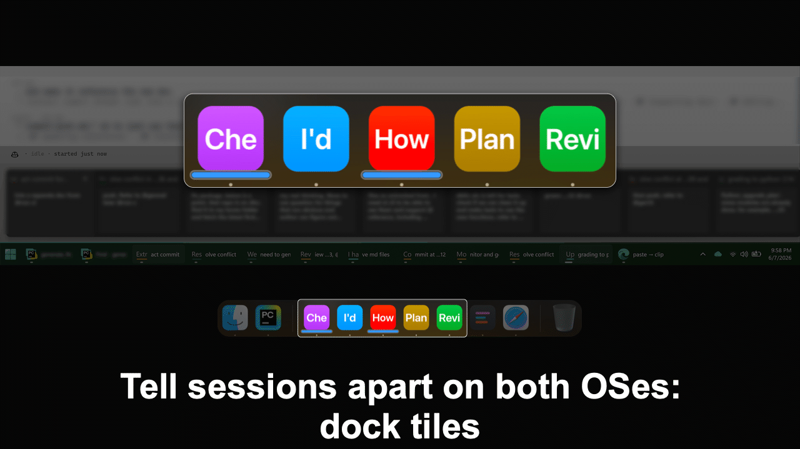
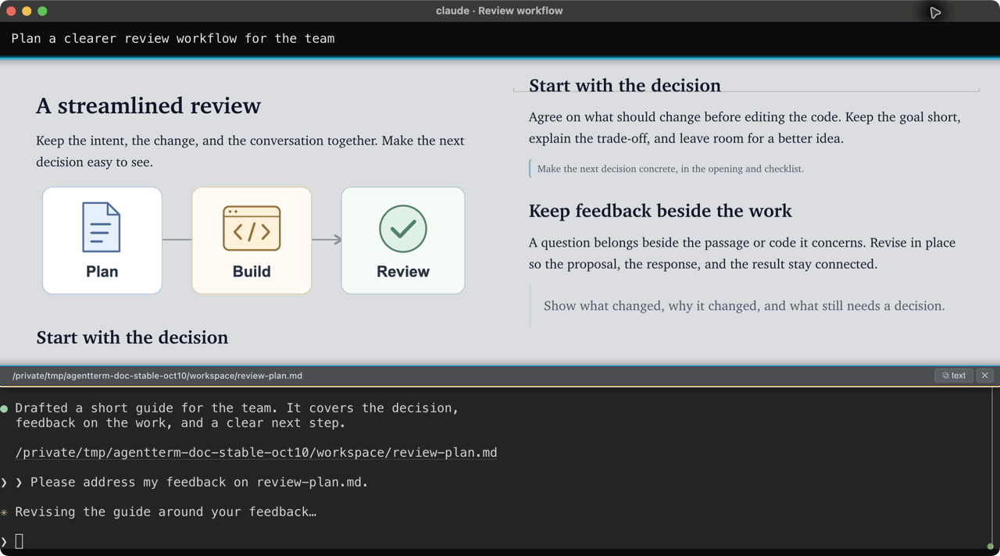
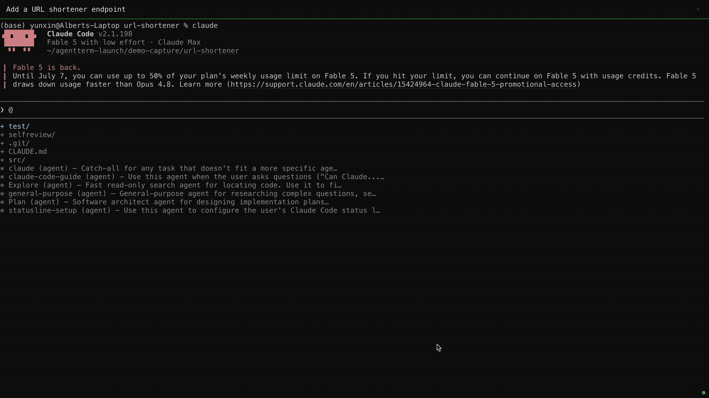
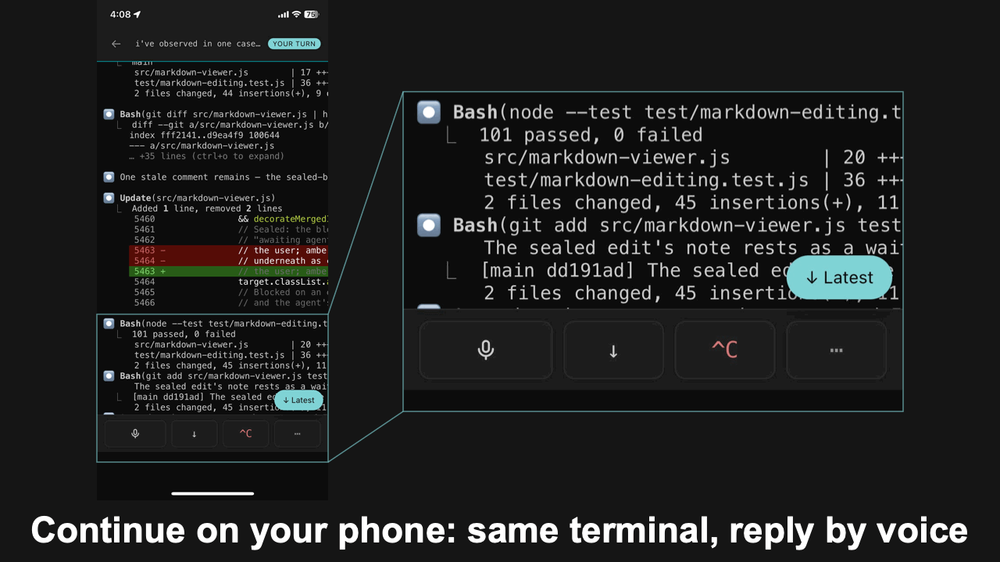
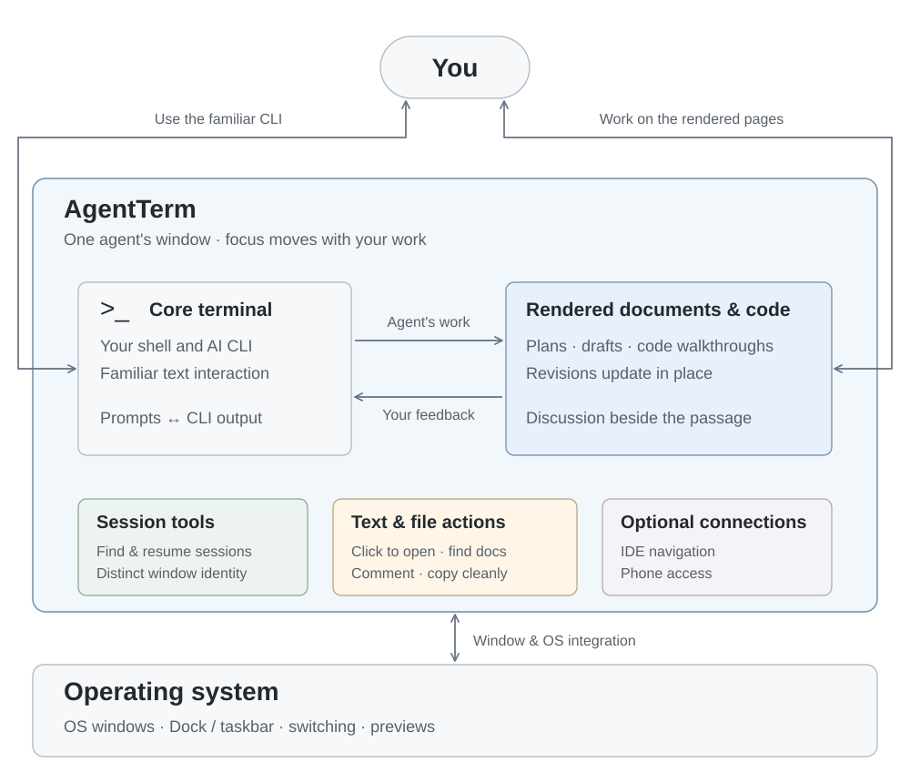

<a name="agentterm"></a>
<a name="agentterm-a-terminal-built-for-coding-agents"></a>
<a name="agentterm-a-super-terminal-for-coding-agents"></a>
<a name="agentterm-a-super-terminal-for-you-and-your-coding-agents"></a>
<a name="agentterm-a-super-terminal-for-you-and-your-agents"></a>
<a name="agentterm-a-greatly-expanded-terminal-for-you-and-your-agents"></a>
<a name="agentterm-a-portal-to-ai"></a>

# AgentTerm: [Your portal to AI](https://yunxin.github.io/rethink-terminal/)

Runs from source on macOS and Windows (through WSL). [Quick start](#quick-start).

<a id="demo"></a>

AgentTerm is a full terminal where your existing and new AI CLI sessions run as usual. But it turns each session's terminal window into a rich visual workspace for the new way of working with multiple agents, docs, and code *(autoplays after loading)*:

[](https://raw.githubusercontent.com/albertwujj/agent-term/main/docs/assets/hero-demo-e15f93a91bc1.gif)

*View a frame:* [macOS sessions](https://raw.githubusercontent.com/albertwujj/agent-term/main/docs/assets/frames/sessions-1.png?v=7bf806f6fa73) · [Windows sessions](https://raw.githubusercontent.com/albertwujj/agent-term/main/docs/assets/frames/sessions-2.png?v=9d883735668d) · [Resume](https://raw.githubusercontent.com/albertwujj/agent-term/main/docs/assets/frames/resume.png) · [Comment](https://raw.githubusercontent.com/albertwujj/agent-term/main/docs/assets/frames/comment.png) · [Docs 1](https://raw.githubusercontent.com/albertwujj/agent-term/main/docs/assets/frames/docs-1.png?v=e64928d57d17) · [Docs 2](https://raw.githubusercontent.com/albertwujj/agent-term/main/docs/assets/frames/docs-2.png?v=eaf87d5808f8) · [Docs 3](https://raw.githubusercontent.com/albertwujj/agent-term/main/docs/assets/frames/docs-3.png?v=08a1a3cecb05) · [Code 1](https://raw.githubusercontent.com/albertwujj/agent-term/main/docs/assets/frames/code-1.png?v=9b248f9bfdb7) · [Code 2](https://raw.githubusercontent.com/albertwujj/agent-term/main/docs/assets/frames/code-2.png?v=cac9bb8f8eb4) · [Code 3](https://raw.githubusercontent.com/albertwujj/agent-term/main/docs/assets/frames/code-3.png?v=db149baa47b4) · [Phone 1](https://raw.githubusercontent.com/albertwujj/agent-term/main/docs/assets/frames/phone-1-e58c3dbfe6c6.png) · [Phone 2](https://raw.githubusercontent.com/albertwujj/agent-term/main/docs/assets/frames/phone-2-1266e3d01d5d.png).

*Dive deeper:* [Tell apart](docs/sessions.md#switch-to-the-right-running-session) · [Resume](docs/sessions.md#find-and-resume-sessions) · [Comment](docs/comment.md) · [Docs](docs/plan.md) · [Code](docs/review.md) · [Phone](docs/phone.md).

<a name="whats-added-so-far"></a>

## Work with your agents

As agents take on more implementation, traditional IDE functions take a back seat, and your energy and focus shift toward plans, reviews, and managing several agents at once. The expanded terminal supports that work visually, like an IDE.

<a name="one-os-window-per-session"></a>

<a name="each-agent-session-has-its-own-os-window-and-identity"></a>

<a name="each-agent-has-its-own-os-window-and-identity"></a>

### Each agent gets its own OS window and identity

Tools like tmux and manager apps hold every agent session in one window. AgentTerm gives each session its own window instead, since the OS already provides familiar, mature tools for arranging windows and switching between tasks: the taskbar, Dock, Mission Control, and alt-tab. Separate windows and processes let AgentTerm build on those strengths and add what agent sessions need. Each session has a unique visual identity that helps you find it in the taskbar or Dock and recognize it when previewing or switching windows. To keep the taskbar or Dock easy to scan, AgentTerm hides sessions you haven't used recently; the [session picker](docs/sessions.md) brings them back. [The design note on this decision](https://yunxin.github.io/rethink-terminal/own-os-window/) goes deeper, including its challenges.

[](https://raw.githubusercontent.com/albertwujj/agent-term/main/docs/assets/hero-session-switching.gif?v=bd822b091be5)

**[Type a few letters to find and resume a closed session](docs/sessions.md#find-and-resume-sessions)**; the picker searches your prompts and session titles to help you return to the session.

### Plan, draft, and revise in place

In a CLI conversation, revisions usually arrive as more output. Here, plans and drafts are revised in place, while comments and replies accumulate beside the relevant passage. Your feedback goes back to the same agent.

Ask for a plan as a Markdown file and click its name. On the rendered page, **[comment on any passage or write changes directly](docs/plan.md)**. Your edits are proposals: the agent discusses your feedback in a thread beside the passage and updates the document to reflect your intent. AgentTerm shows what you proposed and what the agent changed.

<p align="center">
<a href="https://raw.githubusercontent.com/albertwujj/agent-term/main/docs/assets/viewer-window-changes-86df8ad3f2.gif"></a>
<br><strong>Work on a document right in the terminal.</strong> The document area expands in full and closes as your focus shifts. Green highlights show the agent’s changes in response to your feedback.
</p>

### Review changes with context

The agent hands you a **[curated review, rendered](docs/review.md)**, with a narrative you can follow and the parts that need your attention called out; you comment inline, it fixes and replies in place.

It can leave out routine changes and decisions you have already settled, and flag trade-offs for you to confirm. You can ask the agent to expand any part, or include all changes in the review, with the parts that most need your judgment first.

[](https://raw.githubusercontent.com/albertwujj/agent-term/main/docs/assets/review-loop.gif)

For example, ask your agent for a curated review with `@produce-r`, which completes to [produce-review.md](https://github.com/albertwujj/agent-threads/blob/main/code/produce-review.md). The agent curates and presents the changes for you to review and comment on.

## Quick start

AgentTerm runs directly from the rolling `main` branch of a source checkout. There is no installer or release to download.

### Ask your agent

The recommended setup installs the terminal with guides for plans, reviews, checkout locks, long jobs, and voice interpretation. Copy this prompt:

```text
Clone https://github.com/albertwujj/agent-term to ~/agent-term.
Follow the recommended setup in its docs/setup.md for my current
project, then launch AgentTerm there.
```

### Or start with the terminal, plans, and reviews

Install Node.js first. On Windows, use WSL for the checkout and project, and install Node.js in both WSL and Windows; the [platform instructions](docs/dev/install.md#windows-with-wsl) have the prerequisites.

```bash
git clone https://github.com/albertwujj/agent-term ~/agent-term
```

On macOS, install dependencies once:

```bash
npm --prefix ~/agent-term ci
```

On Windows, the start command installs the native window's dependencies itself.

Then, from your project's directory, add the document and review guides and launch:

```bash
git clone https://github.com/albertwujj/agent-threads ai/agent-threads
npm --prefix ~/agent-term run start
```

Keep `ai/` out of `.gitignore` so your agent can find the guide files. The [setup guide](docs/setup.md) covers the full suite and reusing existing clones. Read [what AgentTerm touches](SECURITY.md#what-agentterm-touches) if you want to inspect its file, data, and network use first.

Once a window opens, [resume your previous session](docs/sessions.md#resume-an-existing-cli-session) or [start a new one](docs/sessions.md#start-an-agent), and work as usual.

<a id="where-to-go-next"></a>

## What's next

The [recommended setup](docs/setup.md#recommended-setup) also includes guides for the checkout lock and long jobs. Each companion tool can be used on its own; the [suite guide](docs/suite.md#using-the-components) explains when and how to use them.

| Plain terminal | AgentTerm |
|---|---|
| **Comment**<br>manually quote past output | **[Select anything the agent prints and comment](docs/comment.md)**. |
| **Copy**<br>every paste needs cleanup | Copy what the agent wrote and it **[pastes into a chat or email ready to send](docs/copy.md)**, one clean paragraph instead of chopped lines. A doc in the viewer copies the same way. |
| **View**<br>can't click a file name to see it | Click a file the agent mentions (a doc, an image, a video, a PDF) and **[see it right in the window](docs/viewer.md)**, above your prompt; it gets out of the way as your focus shifts. |
| **Shared checkout** collisions<br>test ports, even with worktrees | Type one `@` mention (`@proceed-b` completes to the guide doc's path) and the agent **[takes the checkout lock](docs/lock.md)** and cuts a branch before its first edit; a padlock at the top right of each window shows who holds it. |
| **Long jobs**<br>unresponsive, or a missed finish | The agent starts a CI run or other long job and hands the terminal back; **[the job reports its own completion](docs/jobs.md)** through the terminal and the idle agent is prompted to pick it up, even across a session restart; a runner icon at the top right shows what is running. |
| Not an **IDE**<br>can't jump from a cited symbol or line to the code | Click any file:line or symbol the agent cites and **[your IDE jumps to that exact line](docs/ide.md)** after a brief pause for selection; Ctrl/Cmd-click jumps immediately. The editor stays read-only so a stray key changes nothing. |

**Press `Ctrl/Cmd+Shift+U` to find and open a Markdown file by name**, even if it hasn’t appeared in the terminal.

### Phone companion

**[See which agents need you across your machines](docs/phone.md)**. Open the same terminal on your phone, with the same layout so you recognize at once what you left behind; reply by voice.

The phone complements desktop sessions: check progress and send a reply while the agent continues running on your computer. It needs a self-hosted [agent-stream-hub](https://github.com/albertwujj/agent-stream-hub) relay; voice input also needs recording and transcription configured there. [Phone setup](docs/phone.md#setup) is separate from the local components above.

[](https://raw.githubusercontent.com/albertwujj/agent-term/main/docs/assets/hero-phone-voice-bdfc76906a51.png)

[](docs/assets/architecture.svg)

<a name="why-extend-the-terminal"></a>
<a name="why-expand-the-terminal"></a>
<a name="why-build-on-the-terminal"></a>
<a name="terminal-as-the-foundation"></a>
<a name="the-terminal-is-only-the-foundation"></a>
<a name="transforming-the-terminal-into-an-agent-workspace"></a>

## Turning the terminal into an agent workspace

AgentTerm brings IDE and desktop app capabilities to the work that matters with agents: shaping plans, reviewing results, and steering changes. You keep your choice of AI CLI while working directly in documents and reviews, without expressing every adjustment as another terminal prompt.

The whole window follows your focus. Conversation in the terminal helps an idea unfold; AgentTerm's rendered documents and reviews give the result a stable place to be refined and checked. They take turns filling the window, with revisions and replies beside the relevant passage. The [design note](https://yunxin.github.io/rethink-terminal/files-in-terminal/) explains this approach.

## How it works

AgentTerm runs your existing AI CLI in a full terminal, using Electron for the window, xterm.js for terminal emulation, and node-pty for the shell connection. The host parses terminal output for file references and recognized conventions, and keeps track of mentioned documents even when the CLI redraws the screen.

Those references connect the conversation to host capabilities. A Markdown path identifies a document the host can render. A `review://` reference can trigger validation, rendering, and automatic opening of a review. Document viewing and review build on this mechanism. Guide files tell agents how to follow these conventions. For example, [agent-threads](https://github.com/albertwujj/agent-threads) provides the guides and file protocol for document and review feedback.

To keep the terminal responsive, repeated scans are combined and scheduled, while file checks and review rendering run asynchronously.

### A stable interface between agents and AgentTerm

This path can look hacky: the host parses text and reacts to it. Useful text conventions tend to persist, and in practice the patterns we rely on have held up well. We occasionally add support for new patterns, and those updates have been among the easier parts to maintain. It works from both sides: guide files instruct agents to print what the host understands, and the parser recognizes output styles agents already use. This integration does not require a vendor SDK or API. The [design note on this text interface](https://yunxin.github.io/rethink-terminal/plain-text-interface/) covers its parsing and trade-offs.

With a host that understands its agents, and agents that understand the host, an agent can use capabilities beyond those built into its CLI. For example, a plan the agent mentions can open inside the same window, rendered for you to read and write on. Through its protocol with the host, the agent treats what you write as intent and updates the plan in place.

[](docs/assets/agentterm-capabilities.svg)

<a name="make-it-fit"></a>

### Extend it further

You and your agents can change and extend this terminal, down to its code, to fit your work and your team's.

Use it and explore first; what you need may already be there. When you find something is indeed missing while you work, you are best placed to evaluate and fill the gap, with the scenario right in front of you.

This terminal makes that quick: it is already a better tool for working with your agents, including the work to fix itself. Change its source, and every window opened afterward picks up your improvement. Read [Why I run AgentTerm from source](https://yunxin.github.io/rethink-terminal/run-from-source/).

My [design notes](https://yunxin.github.io/rethink-terminal/) share some of the thinking behind AgentTerm.

## Contributing

If you've improved AgentTerm for your work, [share the change](CONTRIBUTING.md) so others can use it too.

MIT licensed. [No telemetry, no account](SECURITY.md#what-agentterm-touches).
