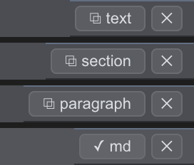

# Copy a doc into a message

A plan or a draft written in the viewer often ends up as a message: a Teams post, an email, a reply on GitHub. The copy button at the right of the viewer's bottom bar copies it in the form the destination needs, so nothing is retyped or cleaned up on the other side. Your comments and unsent edits stay behind, whichever copy you take.

**Formatted text, for Word, Outlook or Teams.** A rich editor receives the doc as it reads in the viewer: headings, bold and italic, lists with their numbering, code, tables, and clickable links. Images are left out.

**Message text, for a plain paste.** A plain-text destination, or a paste as plain text into a rich one, receives the same copy as a message: headings drop out, each paragraph becomes one line, and a blank line separates paragraphs and top-level list items. Ordered lists keep their numbers, nested items stay on their own lines, and code keeps its line breaks. Link URLs are written out, and each table row becomes a labeled block.

**Copy takes what you have clicked.** With nothing clicked, the whole doc. With a heading clicked, the section under it, up to the next heading of the same level. With a paragraph, a list, or a code block clicked, that block. With text selected, the selection, formatting included. Select an embedded image to copy it at full size.

**Markdown, for GitHub or Reddit.** `Ctrl/Cmd`-click the button to copy the markdown source. For a selected image, this copies the source of its containing block.

**From the terminal.** `Ctrl/Cmd+C` on a selection copies it as message text, the terminal's padding removed, so text pasted into an email or a chat needs little or no fixing. `Ctrl/Cmd+Shift+C` copies the selection as a plain terminal would. On Windows, `Enter` with a selection copies the same way.
