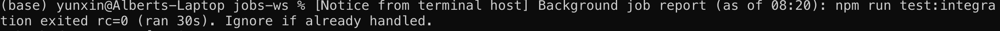
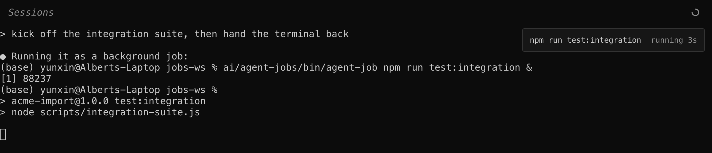

# Long jobs

Some AI CLIs already keep the conversation responsive while a long job runs in the background. [Claude Code](https://code.claude.com/docs/en/interactive-mode#background-bash-commands), for example, supports native background commands. If your CLI also reliably notifies the agent when the job finishes, you may not need `agent-jobs`.

Use `agent-jobs` when native background execution or completion follow-up is missing or unreliable in your CLI or workflow.

## What agent-jobs is

[agent-jobs](https://github.com/yunxin/agent-jobs) provides completion reporting through AgentTerm. The agent starts the job under its `agent-job` wrapper, ends its turn without stopping the work, and hands the terminal back to you. The job reports its own completion, per agent-term's [job-events.md](dev/job-events.md) contract, and when it finishes, the terminal prompts the agent to pick the result up:

[](https://raw.githubusercontent.com/albertwujj/agent-term/main/docs/assets/jobs-nudge.png)

[](https://raw.githubusercontent.com/albertwujj/agent-term/main/docs/assets/jobs-runner.png)

A runner icon at the top right of the window shows the running jobs; click it for the list. How soon the icon and the report follow is in [job-events.md](dev/job-events.md). Closing a session and resuming it does not lose a job: one started before still reports to the session that comes back.

If the agent is busy when the job finishes, the report waits until it is idle. A job that is killed outright writes no report, but the terminal sees that it is gone and tells the agent so, under the same idle rule.

## An example: CI

CI is the example here; any long run goes the same way. Clone agent-jobs into `ai/`, then prompt the agent to run the long job under `agent-job`:

```text
Use agent-job from ai/agent-jobs to run CI, so I can give you other tasks
while waiting for the result.
```

The agent starts CI under `agent-job`, tells you it is running, and ends its turn. When the run finishes, the agent evaluates the result and fixes what it finds, retrying on a transient infrastructure flake, and runs CI again the same way, until CI is green.

The agent can be told to take the [checkout lock](lock.md), or back off while another holds it, when it reworks the code or runs tests that use a shared global resource such as a port.

You can put all of this in one place, a skill or a [verb doc](conventions.md) of your own that combines `agent-job`, the lock and your CI's own requirements, and just reference it in a prompt instead of repeating the above.
