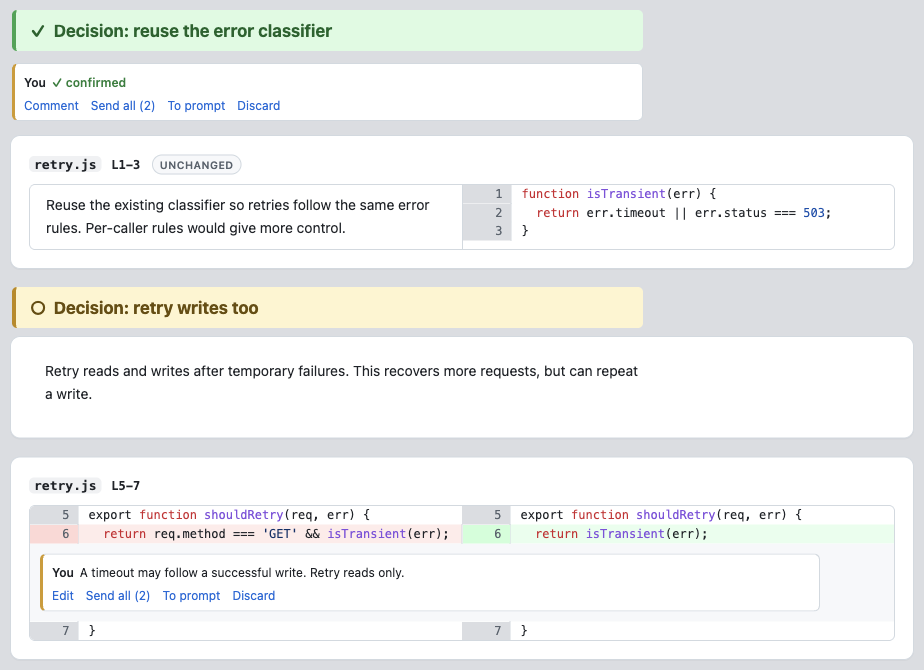
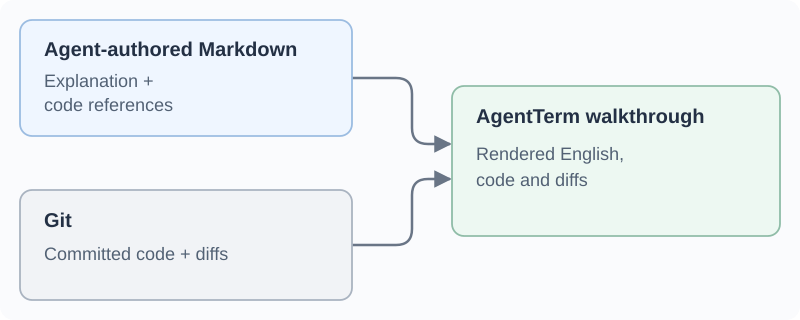

# Curated code review: explanations grounded in code

*Andy Yunxin Wu, October 2026. The fifth in a [series on the design decisions behind AgentTerm](https://yunxin.github.io/rethink-terminal/).*

<a href="https://yunxin.github.io/rethink-terminal/curated-review/">Read the formatted essay</a>

When an agent finishes a code change, I want to understand how the pieces fit together and which choices need my judgment. A full diff shows what changed. Reconstructing the reasoning from it can take considerable work.

## English explains the code, connections and changes; code grounds the explanation

I ask the agent to prepare a curated walkthrough. It groups related changes across files and orders them so I can follow their dependencies. A helper can appear before its callers, with a short explanation of how they relate. Routine changes can be left out so the important parts stand out.

English carries assumptions, alternatives and relationships that no single diff hunk explains. The code makes those claims inspectable. An existing function may matter to understanding a new caller even though the function did not change. The walkthrough can include that code too, with the explanation beside it.

Diff tools can [hint at code moves](https://git-scm.com/docs/git-diff), but not always reliably. An agent can inspect the code to identify what moved and what changed, then explain why in English. Diagrams or other visuals could help in the future.

## Make the choices visible

The agent can give an unsettled decision its own heading, stating what it chose, what it costs and the alternative. That gives me something concrete to question. I can confirm the choice as written or discuss another approach; the agreed choice remains recorded in the walkthrough.

*An illustrative review, with one choice confirmed and another questioned on the code.*

In [the previous essay](files-in-terminal.md), I described discussing and refining a document in the agent's terminal window. Code review uses the same feedback loop.

I can comment on a passage in the explanation or on a code line. The agent answers and revises the explanation or implementation, and the review updates in place. Confirming a design choice and completing a requested fix are separate things: agreeing on the approach still leaves the agent responsible for making the result match it.

## A small package, with code supplied by Git

The agent writes a Markdown review package containing its explanation and references to file ranges. AgentTerm renders those references using code and diffs from Git. The agent supplies the selection and reasoning; the renderer supplies the referenced code.

A review refers to a committed version of the code. The agent updates it as the implementation changes, and AgentTerm warns if the review is out of date or its code references are invalid.

The discussion uses the [same thread contract](https://github.com/albertwujj/agent-threads/blob/main/contract.md) as documents. A comment can identify a passage in the explanation or a line on a particular side of the diff. The discussion remains separate from the generated page, so rebuilding the presentation preserves it. The previous essay covers that shared model in more detail.

## Still learning what makes a good walkthrough

I have used the document workflow much more than the review workflow. I expect to keep improving how much code and explanation a review should include, and how it should be organized.

An early version warned the agent when changed lines were missing from the walkthrough. I removed that check because covering the diff is a different goal from helping me understand the change. I want the agent to choose what needs explaining and how to explain it, while I can ask to go deeper or see the full change.

The part I want to keep improving is how the agent chooses the level of explanation and the code or visuals that help me judge the result.

[AgentTerm: demonstration and setup](https://github.com/albertwujj/agent-term#agentterm)
