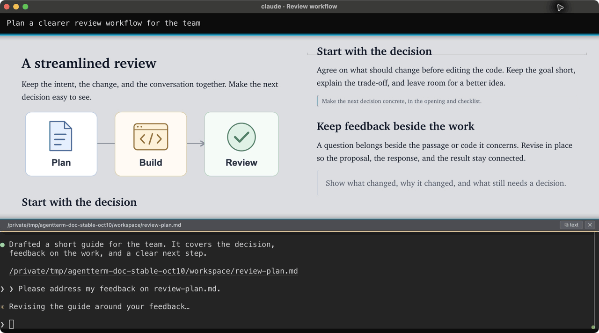
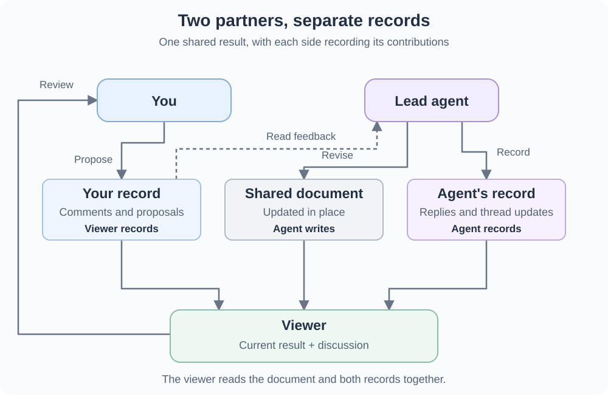
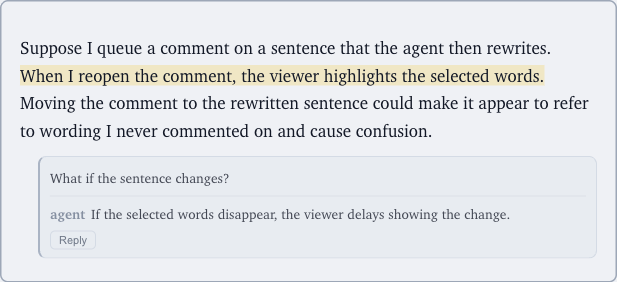

# Why I open documents, code and images right in the agent’s terminal window

*Andy Yunxin Wu, October 2026. The third in a [series on the design decisions behind AgentTerm](README.md).*

I like how a terminal conversation keeps moving. I ask a question, the agent responds, and I follow an idea into the next question. Together we focus on new ideas as they appear where my eyes already are.

AgentTerm adds [direct commenting on the agent's output](../docs/comment.md): I can send an occasional question or correction back to the agent with the quoted passage. If we keep returning to the same passages, especially when those discussions interleave, I ask the agent to [continue in a document](https://github.com/albertwujj/agent-threads/blob/main/conversation/continue-in-doc.md).

The conversation is mostly append-only: new responses follow earlier ones. That works well while I am exploring. As I get closer to a result, my focus shifts to refinement and verification. I am examining incremental changes to what we have already agreed on. I want those adjustments shown in place, with their justification beside them.

In [AgentTerm](https://github.com/albertwujj/agent-term), the same window supports both. **We brainstorm through terminal prompts and output; our agreement is recorded in documents rendered in the same window and revised in place.**

## A stable place to refine the result

When a plan starts to take shape, I ask the agent to write it to a Markdown file. It opens as a rendered document in that agent's window, automatically or when I click the file name.

Now I can find a passage on the rendered page, comment on it or write directly on it to propose a change. The agent works on the file, and the page shows the revision in place, with its reply beside the passage. I can see what changed and keep refining it.

Many rounds of revisions across different passages are hard to follow in a plain terminal conversation. The agent gives each document a descriptive name and saves it in a known location. When I need to revisit one, I type a few letters in AgentTerm to find it.

This works for designs, essays and other drafts. Code has its own review presentation, where the agent connects its explanation to the implementation I need to inspect. Each has a presentation and interaction model tuned to the work. More types of content can be supported later. The goal is to let agents do more for me and make collaboration easier than in traditional interfaces.

## Images need a place to stay

An image is something I want to stop and look at. A diagram may take time to understand, or I may need to refer to it several times while discussing the design. I want it available while new messages arrive.

Some terminals already render images directly. [Ghostty supports the Kitty graphics protocol](https://ghostty.org/docs/features), for example. In AgentTerm, I open an image as a file in the viewer. It has a name I can look up, and a view I can bring forward or close as my focus changes. The same area can show PDFs, video and local pages.

The useful addition is a stable place for what I am inspecting. The terminal can roll forward while I bring up and look at the image at my own pace.

## One window, changing focus

I could open a document in an editor or an image in another app, but keeping it in the agent's window lets me design its placement and size to support the user's focus.

The document can fill the window while I read it. When I send feedback, the view shrinks so I can see the agent pick it up. When I return to the terminal conversation, it rolls up. The agent's revised document comes forward again when it is ready to review.

I want the whole window available for the part of the work I am focused on. The conversation and the document take turns occupying it.

## Find it again without searching the conversation

Closing a view leaves the file available. The viewer picker prioritizes what I have opened and what the session has shown. I can type part of a name to find a document or image again. It also searches nearby files, starting with the project, so I can open something the agent has never mentioned. This lets me bring in earlier information from outside the current session.

## Technical notes: two partners working at once

The agent and I are two partners working on the same result. An AI CLI turn can take a while, so I want to keep reading and preparing feedback while it works on earlier comments. Either of us can have something new while the other is still busy.

### Separate records, one writer each

My writing on the rendered page is a proposal; the agent applies it to the document. That gives the document one writer. The [agent-threads](https://github.com/albertwujj/agent-threads) protocol keeps two separate records of the discussion: the viewer records my comments and proposals; the agent records its replies and thread updates. The viewer combines them beside the current document.

Each side owns what it writes, reducing the risk of overwriting the other's new contribution. Once feedback is sent, we continue by adding follow-ups; the agent records corrections as new events too. The earlier discussion stays available while the document itself changes. We can keep contributing while the other side is working.

The [storage design notes](../docs/dev/maintainer/thread-history-design.md) explain how these records are kept.

### Keep the meaning of a comment steady

Suppose I queue a comment on a sentence that the agent then rewrites. When I reopen the comment, the viewer highlights the selected words. Moving the comment to the rewritten sentence could make it appear to refer to wording I never commented on and cause confusion.

*Example in the viewer: the same passage with a comment thread open.*

Today, the viewer holds an update if it would interrupt my writing or the selected words are gone, and indicates that new content is waiting. That protects my comment's target, but can delay showing the agent's changes.

Updating while I type can distract me; once I have queued a comment and closed its box, it makes more sense to show changes. I expect to keep tuning this balance between showing the latest work and preserving my focus. The [design notes](../docs/dev/maintainer/md-live-updates-design.md) record the current tradeoffs.

[AgentTerm: demonstration and setup](https://github.com/albertwujj/agent-term#agentterm)
