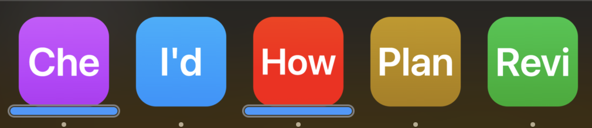
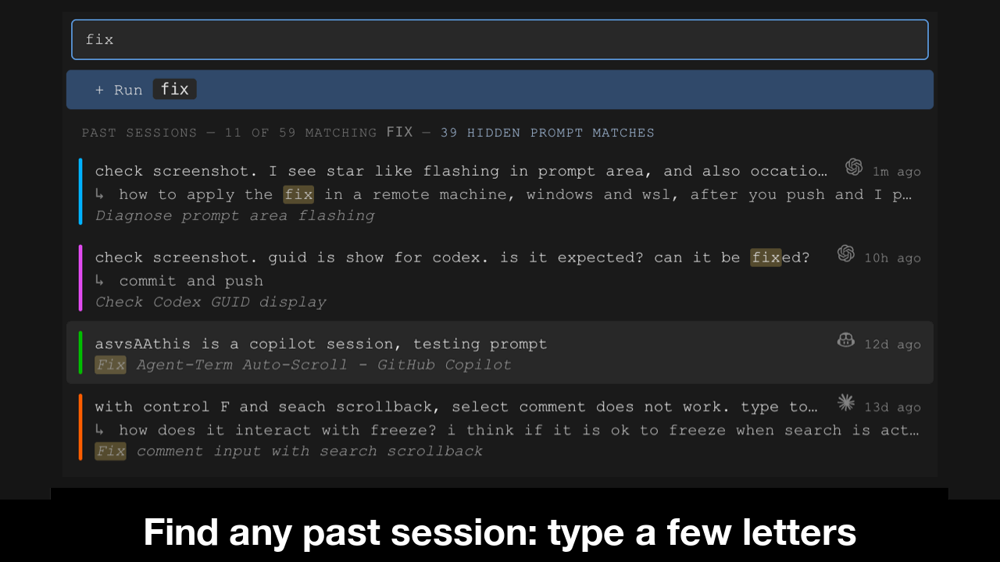

# Why I give each coding agent its own window and Dock tile

*Andy Yunxin Wu, October 2026. The first in a series on the design decisions behind [AgentTerm](https://github.com/albertwujj/agent-term), the terminal I use for all my work with AI CLIs.*

My agent sessions accumulate. A few are active at any moment, one fixing a bug, another with a plan I haven't read yet, and I switch between them all day. Many more are waiting, some on a reply to an email I sent. I keep all of them, because almost any of them may need me again: a finished fix can have follow-ups days later.

Most tools put every session inside one window: panes in tmux, tabs in a terminal, a sidebar or a grid in a manager app. A separate terminal window per agent gets closer, but those windows all look alike. In AgentTerm, **the window is the session: each one runs in its own process, with its own Dock tile or taskbar button**, on macOS and Windows. The tile, the window itself and its previews are each designed so I can tell my agents apart at a glance.

To keep the Dock or taskbar from filling up, AgentTerm hides idle windows while keeping their sessions available.

## The OS already manages windows well

The taskbar, the Dock, Alt-Tab and Cmd-Tab, Mission Control, snapping, multiple monitors and virtual desktops have had decades of work, and my hands already know them. Tabs or a sidebar inside one app hide the agents from all of that: to the OS, they are one window.

More and more of my work lives in agent sessions. One is fixing code, another is helping me write, another is working through a plan. They may use the same CLI, but they feel like different apps to me. Giving each its own place on the desktop feels natural.

When each agent is a window, all of those tools work on agents directly. Snapping, monitors and Spaces arrange agents like any other window. On a Mac, with each agent full screen, one Mission Control swipe shows every agent at once.

## An identity for each agent

Normally there is one Dock tile or taskbar button per app, so all terminals running different coding agents sit under one terminal tile. AgentTerm gives each agent its own tile, showing two things I can recognize at a glance.

**A color.** Each new session takes the color farthest from the colors of the sessions already open, on a wheel tuned so the colors read as plain red, green, blue, orange or purple. They make agents easy to tell apart, and they are pleasant to look at, so I'm at ease and focused.

**My own words.** The tile or button shows the initial letters of my first prompt, and the window's pinned title carries more. I use my prompt rather than a generated summary: I recognize my own words at once, and even a fixed summary needs reading and judging first.

**Locked.** The color and label stay fixed from my first prompt onward, even when I resume a session. A blue tile that says "I'd" seems thin at first, but after a few looks it's as recognizable as an app icon. When I return after a night away, it's still that blue "I'd" tile. If I used a generated summary of the agent's work as the label, it would only be available later. I'd have to interpret it as a new label, and do that again with each update.

The identity carries into the window and its previews. My opening prompts stay pinned at the top of the window, so agents stay distinct in Mission Control. On Windows, hovering a taskbar button shows a card with the first prompt, my latest prompts, the CLI's titles and more, in large text. It replaces the usual shrunken screenshot, a blur of the terminal's latest output in tiny text. On both systems, a mark under the tile or button shows which agents are working.

## Automatic: no renaming or grouping required

Many tools ask me to name sessions or arrange them into projects and workspaces. In AgentTerm, the color and the label come automatically. I never need to rename a session or sort it into folders or groups; its identity is there from my first prompt. Renaming and grouping can be added for anyone who wants them.

Finding an old session needs no grouping either. A session leaves many clues as it runs, and the session picker searches the ones it collects, such as my later prompts. More can be collected, for example the files its agent touched, and the search can grow to use them.

## A process per session

Each window is a separate AgentTerm process, with its own renderer, shell and agent below it. A window that hangs or crashes takes only its own session with it. They don't depend on a central daemon.

The windows self-coordinate, communicating through small files. Each window publishes its state in its own file. To ask another window to act, it leaves a request file, and the receiving window rechecks its own state before acting. Every write uses the usual atomic file rename. Files suit this better than direct IPC: communication is fully asynchronous and crash-resilient by construction.

Every new window starts as a session picker. It reads those files to discover which sessions already have a Dock tile or taskbar button, which have hidden windows still running, and which need resuming. Picking a hidden session asks its window to show itself. Once that window is back, the picker's process exits. If the window's AgentTerm process was stopped to keep memory within the limit, or it crashed, the picker resumes the session in its own window.

A central manager can still complement the windows: each one already streams to [a hub I host](https://github.com/albertwujj/agent-stream-hub), which shows them on my phone, across all my machines.

## The challenges

**Crowding.** If every window stayed in view, one window per session would soon overwhelm the taskbar. So AgentTerm keeps only the windows I'm using as tiles and buttons: when I open a new window, any window I haven't used for about an hour, with its agent idle, gives up its tile or taskbar button. I can also close a window to clear it from the Dock or taskbar right away. Either way, hiding the window leaves its shell and agent running. The window comes back when I pick it in the session picker with a few typed letters, or by itself when its agent finishes a turn. The hour is measured on a clock that moves only while I'm working in AgentTerm, so every window stays through a meeting or a night away.

**Memory.** Each session currently keeps a full Electron instance, even while hidden. A small host process owning each session's terminal would let Electron exit while the shell and agent keep running, bringing a hidden session down to a few tens of MB plus its CLI. I'll build that when there's a need.

Today, on my 8 GB Mac, macOS compresses most of an idle window's memory, leaving about 110 to 150 MB in RAM, plus its CLI. My Mac and my Windows machine both handle it well.

Hidden sessions could all stay alive, but then their memory would add up, so I set a limit of 8 live sessions, hidden and visible together; past that, AgentTerm stops the process for the hidden session that has been idle the longest. I can still resume through its CLI when I pick it.

**Common prompt prefixes.** A prompt that opens with a URL, a file path or an @-mention would put the same letters on those tiles or buttons, such as "http", so AgentTerm skips to the part that differs: the last part of a URL, or a file name without its directories. More heuristics can be added as needed. In the rare case of a collision, different colors help separate them.

**Seams with the OS.** Windows can put back the app's default icon after the machine sleeps, so AgentTerm reapplies the session's icon on wake. On macOS, one system process, the window server, draws the windows of every app. If it crashes, every window disappears at once, while AgentTerm's own process, with its shell and agent, can keep running with nothing on screen. AgentTerm notices the window server restarted, closes the windowless process, and lets me resume the session from the picker in a fresh window.

## Why it was worth it

I switch between agents all day as I do with every other app: a glance at the Dock, a click, Cmd-Tab. My agents sit where the rest of my work sits, each with a distinct identity. As my sessions accumulate, I keep track of them and avoid having so many in view at the same time that I get confused. It's a pleasure to use every day.

The windows are one of many parts of AgentTerm, alongside commenting on agent output and curated code reviews. Next in this series: why AgentTerm skips an installer or package, and how it still runs like an installed app. Running from source makes it easy to personalize: change the code with agents, open a new window, and use the improvement right away.
