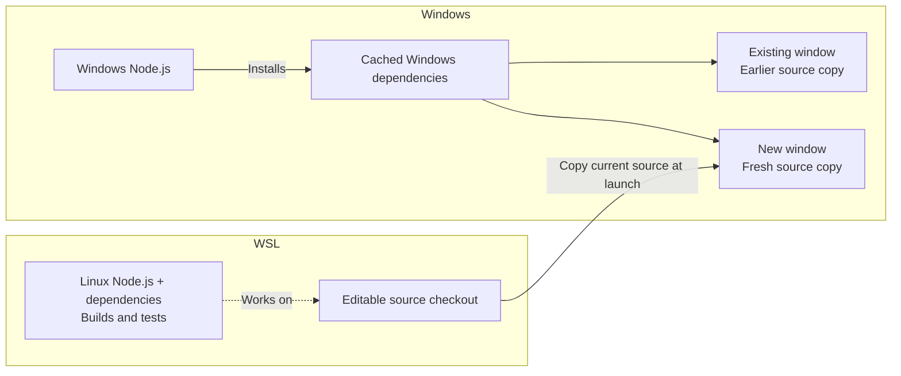

# Why I run AgentTerm from source

*Andy Yunxin Wu, October 2026. The second in a [series on the design decisions behind AgentTerm](https://yunxin.github.io/rethink-terminal/).*

<a href="https://yunxin.github.io/rethink-terminal/run-from-source/">Read the formatted essay</a>

The terminal is where I do most of my work. If a small part of it gets in my way, I can ask an agent to change it, then try the change in the next window I open.

## Runs from source, works like an installed app

[AgentTerm](https://github.com/albertwujj/agent-term) runs from a source checkout, with no installer or application package. The initial setup is to clone the repo, install its dependencies and launch it. That checkout is both the terminal I use and the code I can change.

Once it is running, I rarely need to go back to a shell to run the start command. I can **open a new window with a keyboard shortcut or from the Dock tile or taskbar button's menu**. **Closing the last visible window automatically opens a fresh one.** I can start another instance and run several at once as easily as I would with an installed app.

## The next window runs my changes

Those new windows are also how I try improvements. I ask an agent to edit the checkout, run the relevant checks and verify its changes in a new window. That window runs a separate process on the current source and rebuilds the generated JavaScript before opening. **The window I was working in stays running, even if the new build fails.** To see the improvement myself, I close my window after the agent finishes its turn, then resume its session from the picker on the new code.

On my 8 GB M3 Mac, I [measured](measurements/source-startup-macos-2026-10-12.json) a median **0.41 seconds with unchanged source** and **0.43 seconds after a small UI text edit**, over five launches each. Both cases rebuild the same bundles. Those times run from starting the process to showing the window, with dependencies already installed. A blue banner confirms the launch during that short wait.

The change can be as personal as how I want the session picker's matches to look. I can try it in my own copy, refine it with the agent, and share it if it would help others.

## The extra work for Windows

Windows needs extra launch logic to preserve this workflow. The checkout, shell and agents live in WSL, while Electron runs natively on Windows. Each process gets its own source copy, even when it hasn't changed. New windows can therefore run edited code alongside older ones. Reusing unchanged source copies could be a later optimization, but copying hasn't been a problem in my use.

## When dependencies change

Dependency changes on both platforms still need `npm ci` and the platform's start command.

On macOS, the app and its build tools share the same environment and dependency installation. On Windows, the build tools run in Linux through WSL while the app runs on Windows, so each needs dependencies for its own OS. Windows can also lock files used by a running app. The launcher installs updated Windows dependencies alongside the old ones, so new windows can use them while older windows keep running.

*Source edits reuse cached Windows dependencies. Dependency changes create a new cache generation, letting older windows keep using the previous one.*

## A terminal I can keep changing

Coding agents make it practical to change and personalize the tools I use. With the source at hand, I can ask for a fix and see the improvement the next time I use the tool. [AgentTerm](https://github.com/albertwujj/agent-term) is one of those tools. It's built to help you work better with AI CLIs. You can run agents in it to build and fix your tools, including the terminal itself.

[Try it and tinker with it](../README.md#quick-start).
